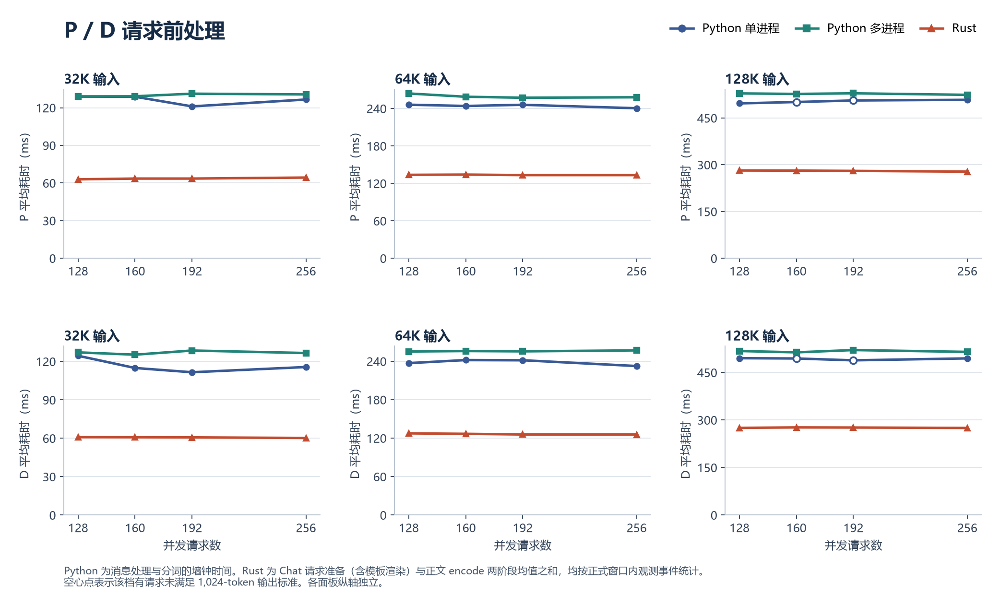
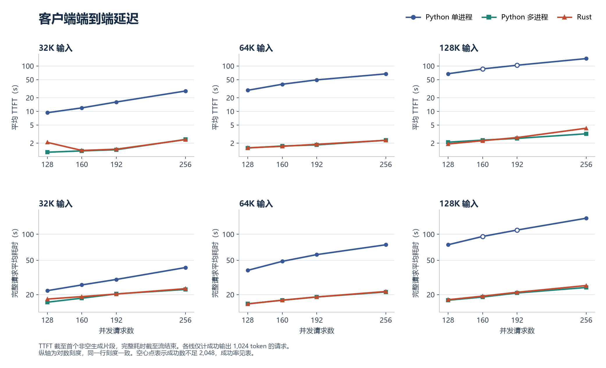

# Aigate DP16 discovery and fixed-length Chat requests

In the 129.1 cluster's 32K/C128 run, Aigate registered one decode endpoint and all 2,048 requests reached DP0. Registering all 16 listeners distributed the rerun evenly: each rank handled 128 requests. Mean time to first token (TTFT) fell from 69.33 s to 2.07 s.

## Register each decode listener

For ongoing deployments, prefer the [Pod-aware reconciler](../../../examples/monitoring/aigate-dp16/README.md).
The static command below reproduces the original benchmark layout only: it assumes
both engine Pods already advertise rank0/rank8 and does not follow rescheduling.

Rust binds each decode ingress to `base_port + global_dp_rank` and submits requests to its local scheduler. EPP in this deployment discovers the port named `sglang-http` on each selected Pod. With only the leader's port in the registry, sending to that address repeatedly selects the same rank.

For the tested two-node, host-network deployment, advertise the following ports:

| Node | Engine Pod's named port | Additional named ports, one discovery Pod per port |
|---|---|---|
| D node 0 | 30000 (rank 0) | 30001–30007 (ranks 1–7) |
| D node 1 | 30008 (rank 8) | 30009–30015 (ranks 9–15) |

Keep the two engine Pods and the additional discovery Pods in the same router group, model and transfer group. Each discovery Pod shares the host IP of its engine and advertises an existing Rust listener. Traffic goes directly to that listener. Reserve each named port only once. Keep each P engine's `aigate.iflytek.com/bootstrap-port` annotation at its actual bootstrap port (8998 here). The three P replicas use separate single-node process groups. Only the two D nodes share a rendezvous address.

To render the 14 additional registrations, supply the real Kubernetes hostname labels, the labels selected by your EPP, and a locally available pause image:

```sh
python scripts/render_aigate_dp16_registrations.py \
    --decode-nodes "$DECODE_HOST_0" "$DECODE_HOST_1" \
    --namespace "$NAMESPACE" --name-prefix "$NAME_PREFIX" \
    --router-group "$ROUTER_GROUP" --transfer-group "$TRANSFER_GROUP" \
    --model "$MODEL" --pause-image "$PAUSE_IMAGE" > dp16-registrations.json
```

Check the rendered Pod placements and labels against the engine Pods. After deploying, check that Aigate's `/v1/models` lists exactly three P and sixteen distinct D addresses. Query each D address at `/v1/loads` and verify its top-level `global_dp_rank` and `global_dp_size=16`. Check the actual Chat request and accepted decode-token counts per rank as well. Registration alone does not establish that requests used all the listeners.

## Why requests ended early

The old Rust Chat adapter forwarded `max_tokens` but dropped `min_tokens` and `ignore_eos` during conversion to scheduler parameters. With the fixed 32K prompt and a requested output of 1,024 tokens, 573 out of 2,048 requests returned HTTP 200 with `finish_reason=stop` after 2–10 tokens. The original records did not retain the terminal token ID for each request.

The fix forwards both fields before sampling normalization. In a separate EOS-biased control with an eight-token limit, the old effective defaults (minimum 0, ignore EOS false) stopped after one token in all four trials. Minimum 8 with ignore EOS true produced eight tokens and `finish_reason=length` in all four trials. In the formal rerun, all 2,048 P and 2,048 D encode events in the first cell carried the expected minimum, maximum and EOS flag.

## What the benchmark measured

The comparison used one fixed Chat body per length, 2,048 submissions per cell, and 1,024 output tokens per successful request. All cacheable P prefix pages were hot. The final 256-token page was recomputed. Times below are means. TTFT ends at the first nonempty generated SSE fragment. Full request time ends when the response stream finishes. Both latency statistics use successful, full-length requests.

| 32K input, concurrency 128 | Python single worker | Python multi-worker | Rust before | Rust after |
|---|---:|---:|---:|---:|
| Full-length successes | 2,048 | 2,048 | 1,475 | 2,048 |
| P preprocessing (ms) | 128.96 | 129.06 | 67.18 | 62.96 |
| D preprocessing (ms) | 124.49 | 127.14 | 61.61 | 60.90 |
| TTFT (s) | 9.33 | 1.26 | 69.33 | 2.07 |
| Full request (s) | 22.20 | 16.32 | 83.15 | 17.75 |
| D aggregate throughput (accepted tokens/s) | 5,568 | 7,272 | 1,168 | 6,707 |

Before the fix, DP0 averaged 15.76 running requests out of its limit of 16, with 107 waiting. All accepted decode tokens were accounted to DP0. After the fix, each D node contributed about 3,354 accepted tokens/s. Corrected TTFT had a median of 1.12 s and a P95 of 14.24 s. The first 128 submissions averaged 16.04 s and submissions 257–2,048 averaged approximately 1.0–1.1 s. All were included in the reported mean.

The Python single-worker deployment had a different bottleneck. Its single D HTTP worker synchronously prepared and tokenized each long Chat request before entering inference. The multi-worker baseline used eight workers per P replica and sixteen at the D leader. At 128K/C256, mean D preprocessing per call was 495 ms with one worker and 515 ms with multiple workers, while mean TTFT was 145.22 s versus 3.20 s. A hot KV prefix still requires the incoming text to be encoded. Queueing before that stage is outside its timer.

The complete corrected Rust matrix had 24,576 full-length successes. In every cell, all 16 D ranks handled 128 requests each, the cacheable prefix hit in full, and the 40 scheduler processes stayed stable. Nodes changed between runs. These results compare deployed services.

| Corrected Rust TTFT (s) | C128 | C160 | C192 | C256 |
|---|---:|---:|---:|---:|
| 32K | 2.07 | 1.38 | 1.47 | 2.38 |
| 64K | 1.57 | 1.70 | 1.88 | 2.30 |
| 128K | 1.91 | 2.26 | 2.65 | 4.25 |

Python preprocessing measures `_process_messages`. The corrected Rust measurement sums Chat preparation (including rendering) and text encoding. The original Rust measurement used DSV4 rendering plus encoding. D throughput is each node's contribution to a shared two-node engine.





The [36-row comparison data](results.csv) includes success counts, latency, TPOT and per-node throughput for the two Python deployments and corrected Rust. The November 5, 2026 corrected benchmark used Rust base `959fdcbed5` with the output fix and temporary timing probes, before the branch's Prometheus update. Its raw archive SHA-256 is `cfdc3c24ba14993d23df4ccb11771e40c102f7790061c9161dc979f3da42539a`.
